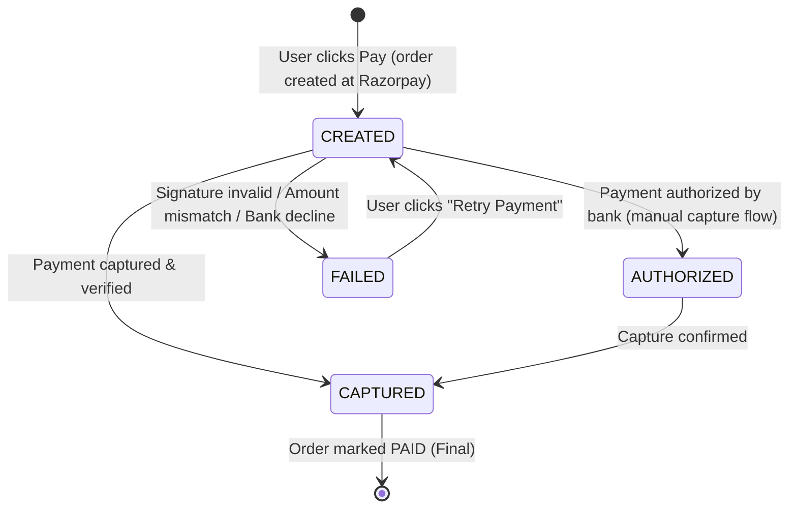

# DevMarket – Razorpay Payment Gateway Integration Guide (Phase 10)

This document provides a comprehensive technical guide to the Razorpay Payment Gateway integration for DevMarket, covering configuration, backend order creation, frontend checkout, cryptographic signature verification, webhooks, duplicate payment protection, automated testing, troubleshooting, and production Live Mode activation.

---

## 1. Architecture Overview

DevMarket operates on the core principle that the **backend is the sole authority for order totals and pricing**. Under no circumstances does the system trust payment amounts, currency, fee percentages, or payment success callbacks originating from the React frontend.

### Component Roles

```
[ Customer Browser ]
       │
       │ 1. Checkout Quote & Review
       ▼
[ React Frontend ] ──(2. POST /api/checkout/create-order/)──▶ [ Django Orders App ]
       │                                                              │
       │ 3. POST /api/payments/create/                                │
       ▼                                                              ▼
[ Django Payments App ] ──(4. client.order.create)──▶ [ Razorpay API ]
       │                                                      │
       │ 5. Returns key_id, rzp_order_id, amount              │
       ▼                                                      │
[ Razorpay Checkout Modal ] ◀─────────────────────────────────┘
       │
       │ 6. Customer completes payment in modal
       ▼
[ Razorpay Modal Callback ] (razorpay_order_id, payment_id, signature)
       │
       │ 7. POST /api/payments/verify/ (Signature + Capture confirmation)
       ▼
[ Django Payments App ] ──(8. Verify HMAC-SHA256 & Fetch from Gateway)──▶ [ Razorpay API ]
       │
       │ 9. Marks DevMarket Order PAID (if captured)
       ▼
[ Order Confirmed Screen ]

[ Razorpay Server ] ──(10. POST /api/payments/webhook/ [X-Razorpay-Signature])──▶ [ Django Payments App ]
                        (Reconciles asynchronous events: payment.captured, payment.failed, order.paid)
```

---

## 2. Environment Variables & Credentials

All secrets are stored exclusively in backend environment variables. The React frontend is never exposed to the `RAZORPAY_KEY_SECRET` or `RAZORPAY_WEBHOOK_SECRET`. Only the public `RAZORPAY_KEY_ID` is transmitted to the frontend as part of the payment session response.

### Environment Variable Specification

| Variable Name | Description | Example / Mode |
|---|---|---|
| `RAZORPAY_MODE` | Operating mode: `test` or `live`. Default is `test`. | `test` |
| `RAZORPAY_KEY_ID` | Active Razorpay Key ID (Test key starts with `rzp_test_`). | `rzp_test_REDACTED` |
| `RAZORPAY_KEY_SECRET` | Active Razorpay Key Secret. Kept confidential. | `xxxxxxxxxxxxxxxxxxxxxxxx` |
| `RAZORPAY_WEBHOOK_SECRET` | Secret configured in Razorpay Dashboard for webhook HMAC-SHA256. | `whsec_xxxxxxxxxxxxxxxxx` |
| `RAZORPAY_TEST_KEY_ID` | Explicit Test Key ID. | `rzp_test_REDACTED` |
| `RAZORPAY_TEST_KEY_SECRET` | Explicit Test Key Secret. | `xxxxxxxxxxxxxxxxxxxxxxxx` |
| `RAZORPAY_TEST_WEBHOOK_SECRET` | Explicit Test Webhook Secret. | `whsec_test_xxxxxxxxxxxx` |
| `RAZORPAY_LIVE_KEY_ID` | Production Live Key ID (Starts with `rzp_live_`). | `rzp_live_REDACTED` |
| `RAZORPAY_LIVE_KEY_SECRET` | Production Live Key Secret. | `xxxxxxxxxxxxxxxxxxxxxxxx` |
| `RAZORPAY_LIVE_WEBHOOK_SECRET` | Production Live Webhook Secret. | `whsec_live_xxxxxxxxxxxx` |

> [!IMPORTANT]
> The `.env` file is excluded from Git via `.gitignore`. Never commit real API credentials to source control.

---

## 3. Backend Implementation & Models

The payments subsystem is housed in `backend/apps/payments/`.

### 3.1 Payment Model (`apps.payments.models.Payment`)

Tracks each payment attempt associated with a DevMarket order:
- `order`: Foreign key to `orders.Order` (`on_delete=models.PROTECT`).
- `gateway`: CharField (`razorpay`).
- `gateway_order_id`: Indexed Razorpay Order ID (`order_...`).
- `gateway_payment_id`: Nullable CharField with unique constraint and database index (`pay_...`). Empty strings are normalized to `None` in `save()` to prevent multi-row unique collision in MySQL.
- `gateway_signature`: Cryptographic signature provided by Checkout callback.
- `amount`: Exact monetary amount in INR `DecimalField(max_digits=12, decimal_places=2)`.
- `currency`: Default `'INR'`.
- `status`: Choices `created`, `authorized`, `captured`, `failed`, `cancelled`.
- `payment_method`: E.g., `card`, `upi`, `netbanking`.
- `failure_reason`: Reason recorded if payment was declined or verification failed.
- `idempotency_key`: Client idempotency identifier.
- `created_at`, `updated_at`, `verified_at`: Timestamps.

### 3.2 PaymentWebhookEvent Model (`apps.payments.models.PaymentWebhookEvent`)

Ensures complete auditability and idempotent processing of gateway webhooks:
- `gateway_event_id`: Unique identifier (`evt_...`). Enforces duplicate-event suppression.
- `event_type`: Webhook event name (e.g. `payment.captured`, `payment.failed`, `order.paid`).
- `payload`: Full JSON payload received from Razorpay.
- `signature_verified`: Boolean verifying raw-body HMAC matching with `RAZORPAY_WEBHOOK_SECRET`.
- `processing_status`: `pending`, `processed`, `failed`, `ignored`.
- `processing_error`: Diagnostic message if event processing encountered an error.
- `received_at`, `processed_at`: Timestamps.

---

## 4. Payment Lifecycle & State Machine



### Business State Rules:
1. **Authoritative Capture**: DevMarket order status is updated to `PAID` **only** upon verified, captured payment confirmation.
2. **Authorized Payments**: If a payment is authorized but not captured, the DevMarket order transitions to `PAYMENT_PROCESSING`. It is **not** marked `PAID` until capture confirmation is received.
3. **No Downgrades from Paid**: If a webhook event `payment.failed` arrives for an order that is already `PAID` (such as a late timeout callback from a prior attempt), the event is marked `IGNORED` and the order status is preserved.
4. **No Overwrite on Retry**: A failed retry attempt creates an independent `Payment` record and never overwrites an existing successful settlement.

---

## 5. Monetary Calculations & Currency Conversion

All monetary calculations use Python `Decimal`. Floating-point arithmetic is strictly prohibited to eliminate precision loss.

Converting INR into paise:
```python
def inr_to_paise(amount: Decimal) -> int:
    if not isinstance(amount, Decimal):
        amount = Decimal(str(amount))
    return int((amount * Decimal('100')).quantize(Decimal('1')))
```

Example:
- DevMarket Order Total: `₹8,025.00`
- Razorpay Order Amount: `802500` paise

---

## 6. API Endpoints

### 6.1 Create Gateway Payment Order
- **URL**: `POST /api/payments/create/`
- **Headers**:
  - `Content-Type: application/json`
  - `X-Guest-Token: <token>` (if guest checkout)
  - `Authorization: Bearer ...` (if authenticated user)
  - `Idempotency-Key: <uuid>` (optional)
- **Request Body**:
  ```json
  {
    "order_number": "DM-0B7CA42D5C05"
  }
  ```
- **Response** (`201 Created`):
  ```json
  {
    "key_id": "rzp_test_REDACTED",
    "razorpay_order_id": "order_PVB1234567890",
    "amount": 802500,
    "currency": "INR",
    "devmarket_order_number": "DM-0B7CA42D5C05",
    "customer": {
      "name": "Jane Doe",
      "email": "jane@example.com"
    }
  }
  ```

### 6.2 Verify Payment Signature
- **URL**: `POST /api/payments/verify/`
- **Request Body**:
  ```json
  {
    "razorpay_order_id": "order_PVB1234567890",
    "razorpay_payment_id": "pay_PVB9876543210",
    "razorpay_signature": "e2a3c7d6b8f1..."
  }
  ```
- **Response** (`200 OK`):
  ```json
  {
    "status": "success",
    "message": "Payment verified and captured successfully.",
    "order_number": "DM-0B7CA42D5C05",
    "payment_status": "captured",
    "already_processed": false
  }
  ```

### 6.3 Gateway Webhook Endpoint
- **URL**: `POST /api/payments/webhook/`
- **Headers**:
  - `X-Razorpay-Signature: <hmac_sha256_hex>`
  - `Content-Type: application/json`
- **Response** (`200 OK`):
  ```json
  {
    "status": "processed",
    "event_id": "evt_abc12345",
    "event_type": "payment.captured"
  }
  ```

### 6.4 Check Payment Status
- **URL**: `GET /api/payments/status/<order_number>/`
- **Response** (`200 OK`):
  ```json
  {
    "order_number": "DM-0B7CA42D5C05",
    "status": "paid",
    "currency": "INR",
    "total_amount": "8025.00",
    "is_paid": true,
    "payments": [
      {
        "id": 1,
        "gateway": "razorpay",
        "gateway_order_id": "order_PVB1234567890",
        "gateway_payment_id": "pay_PVB9876543210",
        "amount": "8025.00",
        "currency": "INR",
        "status": "captured",
        "payment_method": "card",
        "created_at": "2026-11-04T16:50:00Z",
        "verified_at": "2026-11-04T16:50:15Z"
      }
    ]
  }
  ```

---

## 7. Cryptographic Signature Verification

Verification is performed directly in the Django backend using HMAC-SHA256 and constant-time string comparison (`hmac.compare_digest`) to prevent timing side-channel attacks:

```python
message = f"{razorpay_order_id}|{razorpay_payment_id}".encode('utf-8')
expected_signature = hmac.new(
    key_secret.encode('utf-8'),
    message,
    hashlib.sha256
).hexdigest()

is_valid = hmac.compare_digest(expected_signature, razorpay_signature)
```

Additionally, the payment is fetched directly from Razorpay's trusted API (`client.payment.fetch(payment_id)`) to confirm:
1. `order_id` matches the expected DevMarket payment record.
2. `amount` matches the exact order total in paise.
3. `currency` matches `'INR'`.
4. `status` is confirmed `'captured'`.

---

## 8. Webhook Configuration (Razorpay Dashboard)

To receive real-time payment updates from Razorpay:

1. Log in to your [Razorpay Dashboard](https://dashboard.razorpay.com/).
2. Navigate to **Settings** > **Webhooks**.
3. Click **+ Add New Webhook**.
4. In **Webhook URL**, enter your public HTTPS endpoint:
   ```
   https://api.yourdomain.com/api/payments/webhook/
   ```
5. In **Secret**, enter a strong random secret (e.g. 32 alphanumeric characters) and set this same value in your environment as `RAZORPAY_WEBHOOK_SECRET`.
6. Under **Active Events**, select:
   - `payment.captured`
   - `payment.failed`
   - `order.paid`
7. Click **Create Webhook**.

---

## 9. Testing & Quality Assurance

Automated tests mock all outbound network calls to Razorpay so that tests can run offline, fast, and without expending gateway quota.

To run the complete test suite:
```bash
# Run payment tests
python backend/manage.py test apps.payments

# Run all backend tests across all apps
python backend/manage.py test apps
```

### Manual Testing with Razorpay Test Mode

1. Set `RAZORPAY_MODE=test` in `.env`.
2. Configure `RAZORPAY_KEY_ID` and `RAZORPAY_KEY_SECRET` with Razorpay test keys (`rzp_test_...`).
3. Start the backend (`python manage.py runserver`) and frontend (`npm run dev`).
4. Add items to cart and proceed to Checkout (`/checkout`).
5. Click **Pay with Razorpay**.
6. In the modal:
   - **Success Card Test**: Use Razorpay standard test cards (e.g. OTP `123456`).
   - **Declined Card Test**: Use a simulated failing card number or click "Fail Payment".
   - **Modal Dismissal Test**: Close the Razorpay popup using the (X) button. The page displays a non-destructive pending state with a **Retry Payment** button.

---

## 10. Steps to Switch to Live Mode (Production)

Follow this checklist before processing live money:

1. **KYC & Account Activation**: Ensure your Razorpay account has completed KYC approval and is in **Live Mode**.
2. **Environment Variables**:
   ```env
   RAZORPAY_MODE=live
   RAZORPAY_LIVE_KEY_ID=rzp_live_REDACTED
   RAZORPAY_LIVE_KEY_SECRET=your_live_key_secret
   RAZORPAY_LIVE_WEBHOOK_SECRET=your_live_webhook_secret
   ```
3. **Key Prefix Validation**: The backend automatically validates that `RAZORPAY_MODE=live` requires a key starting with `rzp_live_`. Any attempt to use `rzp_test_` in live mode will raise an immediate configuration exception.
4. **HTTPS Enforcement**: Ensure your production domain enforces TLS/HTTPS. Razorpay Checkout will reject insecure HTTP origins in live mode.
5. **Production Webhook**: Configure the production webhook in Razorpay Dashboard with your live webhook secret.
6. **Disable Debug**: Set `DJANGO_DEBUG=False` in production.

